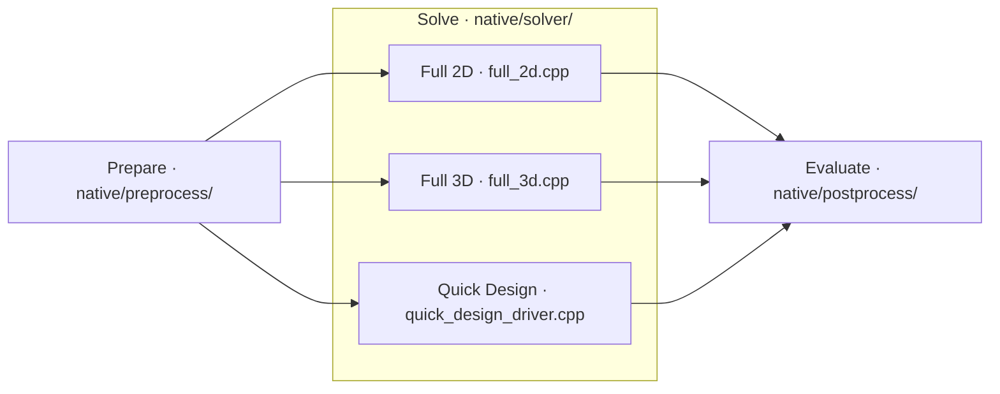

# SJTU-TPMSHX-TM1

[中文](README.md) · English

TM1 calculates flow, heat transfer and pressure drop in TPMS heat exchangers. It supports full 2D and 3D cases, Quick Design and Bayesian optimization. C++ performs the calculations. Python provides the GUI, CLI and application interfaces.

## Where to find the computation code

Start with the [2D air example](examples/cpp/air_2d.cpp#L32-L34) to see the three calls in order. Python applications can run a full case with [compute](python/compute.py#L15).

| Stage | C++ source | Python entry |
| --- | --- | --- |
| Prepare the case | [2D case preparation](native/preprocess/preparation_case.cpp#L1021) · [Geometry](native/geometry/) | [prepare_case](python/preprocess/api.py) |
| Solve | [Full 2D](native/solver/full_2d.cpp#L1095) · [Full 3D](native/solver/full_3d.cpp#L1505) · [Quick Design](native/solver/quick_design_driver.cpp#L116) | [run_case](python/solvers/api.py) |
| Evaluate the results | [Metric evaluation](native/postprocess/result_stage.cpp#L1164) | [evaluate](python/postprocess/api.py) |

For fluid properties and common numerical methods, open [native/numerics/](native/numerics/). For flow and thermal models, field results or checkpoints, use the [solver guide](native/solver/README.en.md).

## Run TM1

Full computation and the GUI support macOS arm64 (Python 3.13) and Windows x64 (Python 3.12 or 3.13). Linux x86_64 supports independent result evaluation.

| Task | Start here |
| --- | --- |
| Run a first case | [Install and build from source](docs/first-run.en.md) · [2D and 3D CLI examples](docs/first-run.en.md#examples) |
| Use the GUI | [Load a case, run it and view results](docs/gui-guide.en.md) · [Quick Design](docs/gui-guide.en.md#quick-design) · [Optimization](docs/gui-guide.en.md#optimization) |
| Call TM1 from another program | [Python and CLI stage calls](docs/first-run.en.md#stage-api) · [C++ SDK](docs/native-stages.md) · [Data contracts](docs/contracts/three_module_v1/README.md) |
| Develop or verify a change | [Contributor extension guide](docs/extending.md) ([fluid or Nu](docs/extending.md#new-fluid-or-nu-closure), [GUI panel](docs/extending.md#new-gui-panel-or-dialog), [topology](docs/extending.md#third-tpms-topology)) · [Local checks and CI](docs/verification.en.md) · [Collaboration](docs/collaboration.md) |
| Check physical scope or evidence | [Capabilities and limits](docs/capabilities.en.md) · [Model sources](docs/model-resources.en.md) · [Historical results](docs/history/README.en.md) |

[Repository and documentation map](docs/README.en.md) · [Python source map](python/README.en.md) · [Desktop deployment](docs/desktop.en.md)
