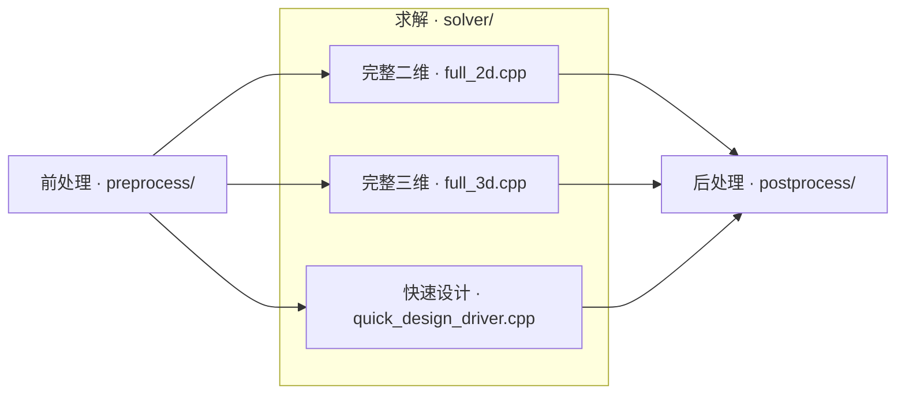

# SJTU-TPMSHX-TM1

中文 · [English](README.en.md)

TM1 用于计算 TPMS 换热器的流动、换热量与压降，支持完整二维和三维工况、快速设计及贝叶斯优化。C++ 负责计算，Python 提供图形界面、命令行和应用接口。

## 计算主代码在哪里

第一次读代码，可以先看[二维空气算例里的三次调用](examples/cpp/air_2d.cpp#L32-L34)。从 Python 运行完整工况，主入口是 [compute](python/compute.py#L15)。

| 计算阶段 | C++ 实现 | Python 入口 |
| --- | --- | --- |
| 准备工况 | [二维工况准备](preprocess/preparation_case.cpp#L1021) · [几何计算](geometry/) | [prepare_case](python/preprocess/api.py) |
| 求解 | [完整二维](solver/full_2d.cpp#L1095) · [完整三维](solver/full_3d.cpp#L1505) · [快速设计](solver/quick_design_driver.cpp#L116) | [run_case](python/solvers/api.py) |
| 评估结果 | [工程指标计算](postprocess/result_stage.cpp#L1164) | [evaluate](python/postprocess/api.py) |

改流体物性或共用数值方法，从 [numerics/](numerics/) 读起。改流动或热学模型、查场结果或续算，按[求解器阅读指南](solver/README.md)找对应文件。

## 运行 TM1

完整计算和图形界面支持 macOS arm64（Python 3.13）和 Windows x64（Python 3.12 或 3.13）。Linux x86_64 支持独立结果评估。

| 我想做什么 | 从这里开始 |
| --- | --- |
| 第一次跑通工况 | [安装环境并构建原生库](docs/first-run.md) · [二维和三维命令行算例](docs/first-run.md#examples) |
| 使用图形界面 | [载入工况、计算与查看结果](docs/gui-guide.md) · [快速设计](docs/gui-guide.md#quick-design) · [优化](docs/gui-guide.md#optimization) |
| 从其他程序调用 | [Python 与 CLI 的三阶段调用](docs/first-run.md#stage-api) · [C++ SDK](docs/native-stages.zh-CN.md) · [数据契约](docs/contracts/three_module_v1/README.zh-CN.md) |
| 开发或验证改动 | [贡献者扩展指南](docs/extending.zh-CN.md)（[流体／Nu](docs/extending.zh-CN.md#new-fluid-or-nu-closure)、[GUI 面板](docs/extending.zh-CN.md#new-gui-panel-or-dialog)、[拓扑](docs/extending.zh-CN.md#third-tpms-topology)）· [本地检查与 CI](docs/verification.md) · [协作流程](docs/collaboration.zh-CN.md) |
| 确认模型能算什么 | [能力与边界](docs/capabilities.md) · [模型来源](docs/model-resources.md) · [历史结果](docs/history/README.md) |

[仓库目录与文档导航](docs/README.md) · [Python 源码地图](python/README.md) · [桌面部署](docs/desktop.md)
